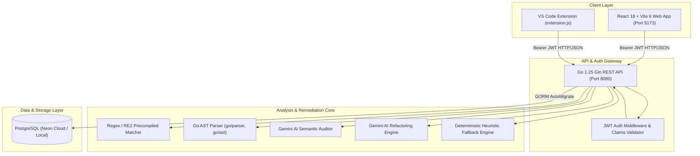

# 🛡️ CodeSentinel — In-Depth Architectural Specification, Progress Status & Problem Analysis Report

---

## 1. Executive Summary & Project Mission

**CodeSentinel** is an enterprise-grade, role-based code governance, static analysis, and AI-assisted remediation platform. It bridges the gap between **Senior Architects / Security Officers** who define organizational quality standards, and **Junior Engineers** who write, audit, and remediate code in real time before submitting pull requests.

The platform eliminates manual code review bottlenecks by:
1. Translating natural language policies into enforceable static analysis rules (AST + Regex).
2. Auditing multi-file source code against active policies in real time.
3. Automatically proposing constrained, line-level code patches using LLMs (Gemini API) and verifying that proposed fixes eliminate the flaw without introducing regressions.
4. Providing dual interfaces: a browser-based IDE workspace and a native VS Code extension.

---

## 2. High-Level Architecture & System Topology



### 2.1 Technology Stack Matrix

| Layer | Technologies & Dependencies | Purpose |
| :--- | :--- | :--- |
| **Frontend Web App** | React 18, Vite 6, Tailwind CSS 4, React Router 7, Radix UI primitives, Lucide Icons, Sonner | Interactive dual workspace (Senior/Junior), code editor, rule governance manager, team administration. |
| **Backend REST API** | Go 1.25, Gin Gonic, GORM, `godotenv`, `crypto/bcrypt`, `golang-jwt/jwt/v5` | High-throughput stateless API serving authentication, rule management, scanning, and metrics. |
| **Database** | PostgreSQL (Neon Serverless AWS pooler / local PostgreSQL) | Relational persistence for users, teams, governance rules, scan records, line violations, and immutable audit logs. |
| **Static Analysis Engine** | Go native `regexp`, `go/parser`, `go/ast`, `go/token` | Fast local AST parsing for Go code and RE2 pattern matching across all text-based source files. |
| **AI Integration** | Google Gemini REST API (`gemini-1.5-flash`, `gemini-2.0-flash`) | Natural language rule generation, contextual line-level code refactoring, and semantic security scanning. |
| **IDE Extension** | Node.js, VS Code Extension API (`vscode`), Axios | Local desktop IDE extension providing on-save inline squiggly diagnostics and quick fixes. |

---

## 3. Database Schema & Data Models

All models are defined under [`server/internal/models/`](file:///d:/Education/SEM%205/Capstone%20project/app/Codesentineluidesigncieignite/server/internal/models):

1. **`User`** ([`users.go`](file:///d:/Education/SEM%205/Capstone%20project/app/Codesentineluidesigncieignite/server/internal/models/users.go#L5)):
   - Stores identity (`name`, `email`, `username`, `passwordHash`), role (`senior`, `junior`), access level (`CEO`, `top_senior_developer`, `manager`, `senior_developer`, `junior_developer`), assigned `team`, and `status` (`Active`, `Pending Invite`).
2. **`Team`** ([`users.go`](file:///d:/Education/SEM%205/Capstone%20project/app/Codesentineluidesigncieignite/server/internal/models/users.go#L20)):
   - Engineering squads with `name`, `description`, and a foreign key to a `leader_id` (`*User`).
3. **`GovernanceRule`** ([`users.go`](file:///d:/Education/SEM%205/Capstone%20project/app/Codesentineluidesigncieignite/server/internal/models/users.go#L42)):
   - Core governance entity containing `rule_code` (e.g., `SEC-001`), `title`, `severity` (Critical, High, Medium, Low), `category`, `coverage` (target stack), `version`, `mode` (`Draft`, `Approved`, `Rejected`, `Enforced`), `status` (`DRAFT`, `ACTIVE`, `ARCHIVED`), `pattern` (Regex/RE2), `npl` (Natural Policy Language directive), `governance` (e.g., OWASP, ISO-27001), `examples`, `remediation`, and senior audit tracking fields (`reviewed_by_user_id`, `review_comment`, `review_completed_at`).
4. **`Project` & `Scan`** ([`scans.go`](file:///d:/Education/SEM%205/Capstone%20project/app/Codesentineluidesigncieignite/server/internal/models/scans.go#L5)):
   - Projects track repository ownership (`owner_id`). Scans record audit runs with `branch`, `files_scanned`, `compliance_score` (0–100%), `risk` (`Critical`, `High`, `Low`), and senior review `note`.
5. **`Violation`** ([`scans.go`](file:///d:/Education/SEM%205/Capstone%20project/app/Codesentineluidesigncieignite/server/internal/models/scans.go#L26)):
   - Individual detected flaw linked to a `ScanID` and `RuleID`, capturing `file`, `line`, `column`, `snippet`, `summary`, `explanation`, `fix`, `enforcement_action` (`BLOCK`, `WARN`), and `status` (`Open`, `Resolved`).
6. **`AuditLog` & `Notification`** ([`notification.go`](file:///d:/Education/SEM%205/Capstone%20project/app/Codesentineluidesigncieignite/server/internal/models/notification.go#L5), [`users.go`](file:///d:/Education/SEM%205/Capstone%20project/app/Codesentineluidesigncieignite/server/internal/models/users.go#L31)):
   - Immutable security trail for rule activations, deletions, user additions, scans, and system notifications targeted by `recipient_user_id` or `recipient_role`.

---

## 4. Current Implementation Progress & Completed Modules

### 4.1 Authentication & Role-Based Access Control (RBAC) — 100% Completed
- **Bcrypt Password Authentication**: Handled via [`POST /auth/login`](file:///d:/Education/SEM%205/Capstone%20project/app/Codesentineluidesigncieignite/server/internal/handlers/auth.go#L35). Password reset endpoint implemented via [`POST /auth/reset-password`](file:///d:/Education/SEM%205/Capstone%20project/app/Codesentineluidesigncieignite/server/internal/handlers/auth.go#L85).
- **Session Restoration & User Context**: Context provider in [`AuthContext.tsx`](file:///d:/Education/SEM%205/Capstone%20project/app/Codesentineluidesigncieignite/src/app/context/AuthContext.tsx) restores JWT tokens from `localStorage` and calls `GET /auth/me` on startup.
- **Client Route Gating**: Implemented in [`ProtectedRoute.tsx`](file:///d:/Education/SEM%205/Capstone%20project/app/Codesentineluidesigncieignite/src/app/components/ProtectedRoute.tsx) and [`routes.tsx`](file:///d:/Education/SEM%205/Capstone%20project/app/Codesentineluidesigncieignite/src/app/routes.tsx) to strictly enforce boundaries between `/senior/*` and `/junior/*`.
- **Backend Middleware Enforcement**: [`middleware.RequireAuth()`](file:///d:/Education/SEM%205/Capstone%20project/app/Codesentineluidesigncieignite/server/internal/middleware/auth.go#L18) and [`middleware.RequireAnyPermission()`](file:///d:/Education/SEM%205/Capstone%20project/app/Codesentineluidesigncieignite/server/internal/middleware/auth.go#L52) guard privileged API operations.

### 4.2 Senior Governance & Rule Engineering — 95% Completed
- **Rule Lifecycle Management**: Full CRUD in [`SeniorRules.tsx`](file:///d:/Education/SEM%205/Capstone%20project/app/Codesentineluidesigncieignite/src/app/components/SeniorRules.tsx) and [`rules.go`](file:///d:/Education/SEM%205/Capstone%20project/app/Codesentineluidesigncieignite/server/internal/handlers/rules.go#L52). Supports transitioning rules between `Draft`, `Approved`, `Enforced`, and `Archived`.
- **AI Rule Synthesizer**: Implemented via [`POST /rules/generate`](file:///d:/Education/SEM%205/Capstone%20project/app/Codesentineluidesigncieignite/server/internal/handlers/rules.go#L303). Prompts Gemini to synthesize a regex pattern, title, category, remediation, and compliance standards from natural language instructions.
- **Safety Gate**: AI-generated rules are programmatically forced into `Draft` mode with `DRAFT` status; they can never automatically enforce or block builds without senior sign-off ([`rules.go:L325-L332`](file:///d:/Education/SEM%205/Capstone%20project/app/Codesentineluidesigncieignite/server/internal/handlers/rules.go#L325-L332)).
- **Local Rule Synthesis Fallback**: When Gemini API is unavailable or offline, `generateFallbackRuleDraft` ([`rules.go:L459-L609`](file:///d:/Education/SEM%205/Capstone%20project/app/Codesentineluidesigncieignite/server/internal/handlers/rules.go#L459-L609)) parses key tokens to construct regex patterns deterministically.

### 4.3 Multi-Tier Static Analysis Engine — 90% Completed
- Located in [`server/internal/scanner/scanner.go`](file:///d:/Education/SEM%205/Capstone%20project/app/Codesentineluidesigncieignite/server/internal/scanner/scanner.go):
  1. **Precompiled RE2 Regex Engine**: Evaluates active rules against files filtered by coverage extensions.
  2. **Go AST Engine**: Parses Go syntax trees using `go/parser` and `go/ast` ([`scanner.go:L709-L1128`](file:///d:/Education/SEM%205/Capstone%20project/app/Codesentineluidesigncieignite/server/internal/scanner/scanner.go#L709-L1128)), catching:
     - Swallowed errors using blank identifiers (`_ = err` or `_ = db.Create()`)
     - SQL string interpolation (`fmt.Sprintf` inside `Query`, `Exec`, `Where`, `Raw`)
     - Insecure TLS flags (`InsecureSkipVerify: true`)
     - Direct `panic()` invocations
  3. **Gemini Semantic Scanner (`RunScanWithAI`)**: Leverages LLM reasoning for deep contextual bugs with zero-hallucination line-content validation ([`scanner.go:L658-L675`](file:///d:/Education/SEM%205/Capstone%20project/app/Codesentineluidesigncieignite/server/internal/scanner/scanner.go#L658-L675)).
  4. **Single-Card Consolidation**: Collapses multiple line hits of the same rule in a file into a single consolidated card to eliminate notification fatigue ([`scanner.go:L117-L120`](file:///d:/Education/SEM%205/Capstone%20project/app/Codesentineluidesigncieignite/server/internal/scanner/scanner.go#L117-L120)).

### 4.4 Junior Workspace & Code Remediation — 90% Completed
- Located in [`JuniorWorkspace.tsx`](file:///d:/Education/SEM%205/Capstone%20project/app/Codesentineluidesigncieignite/src/app/components/JuniorWorkspace.tsx):
  - Multi-file tree navigation with drag-and-drop and folder upload support.
  - Manual **"Analyze Code"** trigger to prevent unsolicited scanning while typing.
  - Syntax check guard preventing scan execution if fatal syntax errors are present.
  - Interactive Terminal Log displaying build steps, compiler output, and audit logs.
  - Two built-in demo datasets: `VIOLATED_PROJECT_FILES` (flawed code) and `COMPLIANT_PROJECT_FILES` (clean code).
  - Undo/redo history stack per file buffer ([`JuniorWorkspace.tsx:L955-L970`](file:///d:/Education/SEM%205/Capstone%20project/app/Codesentineluidesigncieignite/src/app/components/JuniorWorkspace.tsx#L955-L970)).

### 4.5 AI Line-by-Line Auto-Fix & Verification — 90% Completed
- Implemented in [`POST /rules/fix-ai`](file:///d:/Education/SEM%205/Capstone%20project/app/Codesentineluidesigncieignite/server/internal/handlers/rules.go#L648) and [`POST /rules/verify-fix`](file:///d:/Education/SEM%205/Capstone%20project/app/Codesentineluidesigncieignite/server/internal/handlers/rules.go#L884):
  - Sends the specific violating line and surrounding context to Gemini.
  - Returns a strictly constrained replacement line with an AI explanation.
  - Local heuristic fallback for common policy breaches (e.g., hardcoded secrets -> `process.env`, hex colors -> `var(--text-primary)`, `dangerouslySetInnerHTML` -> `DOMPurify.sanitize`, unhandled `await fetch` -> `try/catch`, non-null assertion `!` -> optional chaining `?.`).
  - **Verification Pass**: Re-analyzes the modified file in the Go backend to confirm the violation is eradicated (`VERIFIED_RESOLVED`).

### 4.6 Senior Review Queue & Approvals — 90% Completed
- Located in [`SeniorReviews.tsx`](file:///d:/Education/SEM%205/Capstone%20project/app/Codesentineluidesigncieignite/src/app/components/SeniorReviews.tsx):
  - Squad and team-level filtering of scans and junior developers.
  - Inspection of violations, files, lines, and compliance scores.
  - Senior feedback submission (`POST /scans/:id/review`) and approval workflow (`[APPROVED BY SENIOR]`), which dispatches instant alerts to junior developers.

### 4.7 Administration, Teams & Audit Trail — 100% Completed
- Located in [`SeniorAdministration.tsx`](file:///d:/Education/SEM%205/Capstone%20project/app/Codesentineluidesigncieignite/src/app/components/SeniorAdministration.tsx) and [`admin.go`](file:///d:/Education/SEM%205/Capstone%20project/app/Codesentineluidesigncieignite/server/internal/handlers/admin.go):
  - CEO / Admin role hierarchy management.
  - Team creation, assigning team leads, and member management.
  - Account deletion and unapproved account purging.
  - Centralized, queryable audit log table (`audit_logs`) and notification center.

### 4.8 VS Code Desktop Extension — 85% Completed
- Located in [`vscode-extension/`](file:///d:/Education/SEM%205/Capstone%20project/app/Codesentineluidesigncieignite/vscode-extension):
  - Standalone extension communicating with the Go API at `http://localhost:8080`.
  - Registered commands: `codesentinel.scan`, `codesentinel.scanWorkspace`, `codesentinel.login`, `codesentinel.logout`.
  - Real-time `vscode.DiagnosticCollection` mapping backend violations to editor squiggly underlines (Red for Critical/High, Yellow for Medium/Low).
  - Background `onDidSaveTextDocument` automatic scanner listener.

---

## 5. In-Depth Diagnostic: Critical Problems, Gaps & Architectural Vulnerabilities

Despite extensive functionality, the application currently faces **8 major architectural problems and limitations** that need direct remediation:

---

### Problem 1: The "Ghost File" Problem (Missing Scanned File Persistence)
- **Root Cause**: In [`server/internal/models/scans.go`](file:///d:/Education/SEM%205/Capstone%20project/app/Codesentineluidesigncieignite/server/internal/models/scans.go#L14-L46), the `Scan` entity only stores metadata (`branch`, `files_scanned`, `compliance_score`, `risk`), and the `Violation` entity only stores `file`, `line`, `snippet`, and summary. The full source code files uploaded during a scan are **never written to the database or file storage**.
- **User Impact**:
  1. When a junior developer views past scans in [`JuniorDashboard.tsx:L53-L89`](file:///d:/Education/SEM%205/Capstone%20project/app/Codesentineluidesigncieignite/src/app/components/JuniorDashboard.tsx#L53-L89) and clicks *"Open in Workspace"*, the frontend has to inject a **fake, hardcoded stub file** (`const dbPassword = "SuperSecretPassword123!"...`) because the original file content was lost.
  2. In [`ViolationDetails.tsx:L36`](file:///d:/Education/SEM%205/Capstone%20project/app/Codesentineluidesigncieignite/src/app/components/ViolationDetails.tsx#L36), opening a direct violation URL displays a fallback placeholder: `"// Source code snippet for line ... is not included in the scan result"`.
  3. In [`SeniorReviews.tsx`](file:///d:/Education/SEM%205/Capstone%20project/app/Codesentineluidesigncieignite/src/app/components/SeniorReviews.tsx), senior reviewers cannot inspect the full file context or diffs—they can only see isolated one-line snippets.
- **Severity**: **Critical (P0)**

---

### Problem 2: Monolithic Frontend Components & State Bloat
- **Root Cause**: Component files have grown excessively large:
  - [`JuniorWorkspace.tsx`](file:///d:/Education/SEM%205/Capstone%20project/app/Codesentineluidesigncieignite/src/app/components/JuniorWorkspace.tsx): **2,788 lines (118.8 KB)** in a single file!
  - [`SeniorRules.tsx`](file:///d:/Education/SEM%205/Capstone%20project/app/Codesentineluidesigncieignite/src/app/components/SeniorRules.tsx): **1,161 lines (58.7 KB)**.
  - [`SeniorAdministration.tsx`](file:///d:/Education/SEM%205/Capstone%20project/app/Codesentineluidesigncieignite/src/app/components/SeniorAdministration.tsx): **890 lines (39.8 KB)**.
- **Technical Consequences**:
  - `JuniorWorkspace` houses file tree parsing, drag-and-drop listeners, code editor rendering, gutter line rendering, AST syntax checking, terminal emulator, local rule evaluation, undo history, AI proposal modal, and full mock datasets in one giant React component.
  - Every keystroke in the editor re-evaluates syntax and causes top-level component re-renders, causing noticeable input lag on larger files (> 500 lines).
- **Severity**: **High (P1)**

---

### Problem 3: Plain HTML Textarea Editor vs True IDE/Monaco Integration
- **Root Cause**: The workspace editor in [`JuniorWorkspace.tsx:L2316-L2326`](file:///d:/Education/SEM%205/Capstone%20project/app/Codesentineluidesigncieignite/src/app/components/JuniorWorkspace.tsx#L2316-L2326) is a raw HTML `<textarea>` with a separate `<div>` gutter for line numbers synchronized via an `onScroll` event listener.
- **Limitations**:
  - **No Real Syntax Highlighting**: Source code is rendered as monochrome plain text. Keywords, variables, types, and strings are indistinguishable.
  - **Gutter Desynchronization**: While `wrap="off"` is set, any browser font rendering discrepancies, fractional line-height rounding, or pinch-zooming can cause line numbers in the gutter to shift out of alignment with the textarea lines.
  - **Lack of IDE Capabilities**: Lacks multi-cursor editing, bracket matching, code folding, auto-indentation, and inline autocomplete.
- **Severity**: **Medium (P2)**

---

### Problem 4: AST Parsing Monoculture (Go AST Only, Regex for Others)
- **Root Cause**: The AST static analyzer [`runGoASTAnalysis`](file:///d:/Education/SEM%205/Capstone%20project/app/Codesentineluidesigncieignite/server/internal/scanner/scanner.go#L709) only parses `.go` files using the Go standard library (`go/parser`).
- **Technical Consequences**:
  - For JavaScript, TypeScript, Python, Java, SQL, CSS, and HTML, CodeSentinel relies **strictly on regular expressions**.
  - Regexes cannot build semantic Abstract Syntax Trees, track variable scopes, or analyze data-flow/taint propagation.
  - Multi-line statements, string concatenations across multiple lines, or code commented out with block comments (`/* ... */`) can trigger false positives or be missed entirely.
- **Severity**: **Medium (P2)**

---

### Problem 5: AI Fragility & Local Fallback Heuristic Limitations
- **Root Cause**:
  1. If `GEMINI_API_KEY` is not provided, is rate-limited (HTTP 429), or expires, the backend falls back to [`generateFallbackRuleDraft`](file:///d:/Education/SEM%205/Capstone%20project/app/Codesentineluidesigncieignite/server/internal/handlers/rules.go#L459) and the local heuristic in [`FixCodeWithAI`](file:///d:/Education/SEM%205/Capstone%20project/app/Codesentineluidesigncieignite/server/internal/handlers/rules.go#L680-L735).
  2. The local fix heuristic only knows **10 hardcoded string replacements** (`process.env`, `var(--text-primary)`, `DOMPurify.sanitize`, `try/catch`, `?.`, `if err := ...; err != nil`, `id = ?`, `logger.info`, `https://`, `JSON.parse`).
  3. Any governance rule that does not match one of these 10 exact patterns will fail to propose a fix, returning the unmodified line to the developer.
- **Severity**: **Medium (P2)**

---

### Problem 6: Credentials & Environment Security Exposure
- **Root Cause**: In [`server/.env`](file:///d:/Education/SEM%205/Capstone%20project/app/Codesentineluidesigncieignite/server/.env), live database credentials (a Neon PostgreSQL cloud URL with username and password) and a Gemini API key are stored in plaintext in the project tree.
- **Risk**: If this repository is shared or pushed to a public or team git remote, live production cloud credentials will be compromised.
- **Severity**: **High (P1)**

---

### Problem 7: Production Bundle Size & Vendor Chunking
- **Observation**: Running `npm run build` produces a warning:
  ```
  dist/assets/index-DDXdPKsY.js   803.53 kB │ gzip: 241.27 kB
  (!) Some chunks are larger than 500 kB after minification.
  ```
- **Root Cause**: Heavy third-party packages (`recharts`, `framer-motion`/`motion`, `@radix-ui`, `lucide-react`) are bundled into a single monolithic bundle without dynamic `React.lazy()` route splitting.
- **User Impact**: Slower initial page load and larger memory consumption on low-end developer machines.
- **Severity**: **Low (P3)**

---

### Problem 8: Lack of Automated Frontend Tests & Extension Packaging
- **Root Cause**:
  - The Go backend has solid unit tests (`go test -count=1 ./...` passes in 1.8s), but the frontend has **zero automated test files** (no Vitest, Jest, React Testing Library, or Playwright setup).
  - The VS Code extension directory lacks a packaging script (`vsce package`) to output a distributable `.vsix` file for one-click installation into developer IDEs.
- **Severity**: **Medium (P2)**

---

## 6. Summary Scorecard & Current State

```
+--------------------------------------------------------------------------------+
| MODULE / SUBSYSTEM             | COMPLETION | HEALTH | PRIMARY BLOCKER / ISSUE  |
+--------------------------------------------------------------------------------+
| Authentication & RBAC          | 100%       | 🟢 OK   | None                     |
| Senior Rule Governance         | 95%        | 🟢 OK   | None                     |
| AI Rule Generation             | 90%        | 🟡 WARN | Rate limits & fallback   |
| Multi-Tier Scanner Engine      | 90%        | 🟢 OK   | AST only for Go files    |
| Junior Workspace UI            | 90%        | 🟡 WARN | 2.8k-line monolithic file|
| AI Code Auto-Fix & Verify      | 90%        | 🟢 OK   | 10-case fallback limit   |
| Senior Review Queue            | 90%        | 🟡 WARN | Cannot view full files   |
| Administration & Audit Logs    | 100%       | 🟢 OK   | None                     |
| Scanned File Persistence       | 30%        | 🔴 FAIL | No DB storage for files  |
| VS Code Extension Shell        | 85%        | 🟡 WARN | Needs .vsix packaging    |
+--------------------------------------------------------------------------------+
```

---

## 7. Actionable Remediation Roadmap

### Immediate Priorities (P0 / P1)
1. **Implement Scanned File Storage**:
   - Add a `ScanFile` table (`id`, `scan_id`, `file_path`, `content`, `size`) in PostgreSQL.
   - When `/scan` is called, persist the scanned files so that `JuniorDashboard`, `ViolationDetails`, and `SeniorReviews` can load real code rather than hardcoded stubs.
2. **Decompose `JuniorWorkspace.tsx`**:
   - Break the 2,788-line file into modular subcomponents:
     - `WorkspaceFileTree.tsx` (File explorer & upload logic)
     - `WorkspaceCodeEditor.tsx` (Code editing & line gutter)
     - `WorkspaceTerminal.tsx` (Terminal simulator & compiler logs)
     - `WorkspaceAIProposalModal.tsx` (Patch preview & verification dialog)
3. **Environment Security**:
   - Remove active secrets from `server/.env`, rotate the Neon DB password, and rely strictly on system environment variables or untracked local configurations.

### Strategic Enhancements (P2 / P3)
4. **Upgrade to Monaco Editor or CodeMirror 6**:
   - Replace `<textarea>` with Monaco Editor (`@monaco-editor/react`) for full syntax highlighting, native inline squiggly markers, and bracket matching.
5. **Multi-Language AST Expansion**:
   - Integrate Tree-sitter or Babel/ESLint parser for JavaScript/TypeScript and Python to achieve true AST analysis across all primary stacks.
6. **Code-Split Vite Bundle**:
   - Configure dynamic imports (`React.lazy`) in `routes.tsx` to split Senior and Junior bundles, reducing bundle size below 200 kB.
7. **Package VS Code Extension**:
   - Add `npm run package` (`vsce package`) to produce a `.vsix` installer for the desktop extension.
